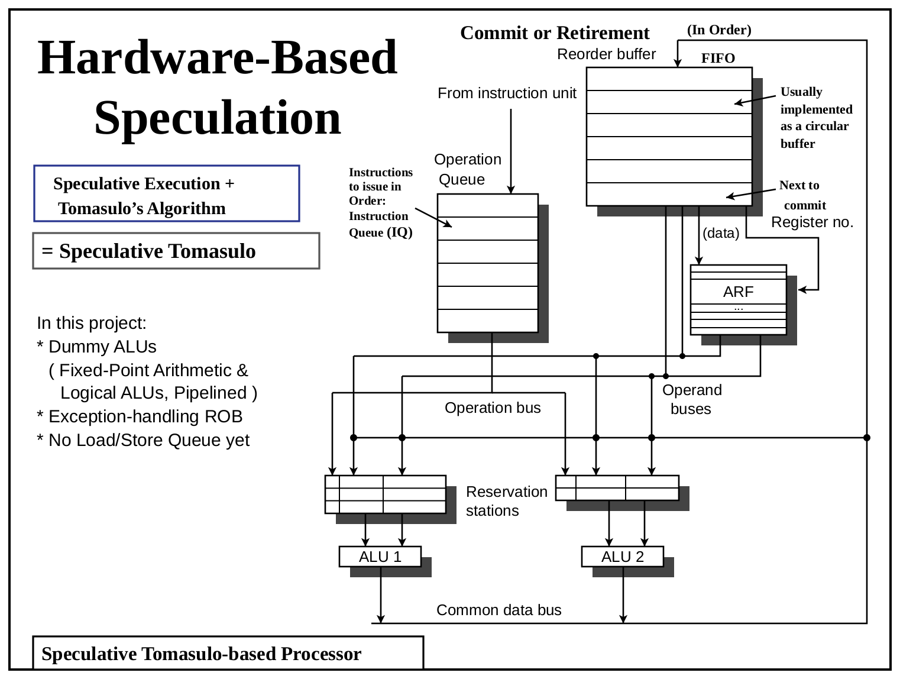

# Hardware-based Speculation (Speculative Tomasulo)
An out-of-order processor in VHDL based on the speculative Tomasulo algorithm.

This version was vibecoded by Nick Kyparissas using Claude Opus 5.5. It is based on the original Speculative Tomasulo project, a Computer Architecture coursework at the Technical University of Crete (School of ECE) by N. Kyparissas and A. Kampylafkas, whose design it restructures, simplifies, documents, tests and corrects. The original version is preserved in the [`original`](https://github.com/nkyparissas/Speculative_Tomasulo/tree/original) branch.



The processor issues one instruction per cycle in program order into the reservation stations of two execution units, executes instructions out of order as soon as their operands are available, and commits them in program order from a 15-entry reorder buffer. The logical unit (OR, AND, NOT) has two reservation stations and a two-stage pipeline, while the arithmetic unit (ADD, SUB, shift left) has three stations and a three-stage pipeline. Both units return their results over a single common data bus. Exceptions are signalled from outside the processor: the reorder buffer then discards the faulting instruction and all younger ones, and instruction fetch continues at an exception handler, whose address the generic `HANDLER_ADDR` of `top_level` sets. A request for a tag that names no instruction in flight is ignored. There are no loads, stores or branches.

The original coursework only required behavioural simulation, and its code was synthesized in Vivado 2018.1. This version is written in VHDL-93 for Vivado as well. It has been simulated with GHDL in VHDL-93 and VHDL-2008 and passes GHDL's synthesis front-end, but it has not been run in Vivado yet. The deviations from the intended behaviour that the original design exhibited are listed, together with their fixes, in [doc/known_issues.md](doc/known_issues.md); no known issue remains open.

## Repository layout

| Path | Contents |
|---|---|
| `rtl/` | The synthesizable design, with `top_level.vhd` as its top and `tomasulo_pkg.vhd` holding the shared definitions. `rom.data` is the default program image, assembled from `programs/example.asm`. |
| `sim/` | The testbench `tb_top_level.vhd` and the Vivado waveform script `waves.tcl`. |
| `programs/` | Assembly programs. `example.asm` is the program of the original project, and the others are tests. |
| `tools/assembler.py` | Assembler, disassembler and reference model of the instruction set. |
| `tests/` | `run_tests.py` (GHDL regression and functional tests), `trace_vcd.py` and the golden traces. |
| `doc/` | Known issues and their fixes, as well as the block diagram and the report (in Greek) of the original project. |

## Instruction set

The processor executes the small instruction set of the original project. An instruction is a 19-bit word that consists of a 2-bit execution unit, a 2-bit function code and three 5-bit register addresses, in a format loosely modelled on MIPS R-type instructions:

| Bits | 18..17 | 16..15 | 14..10 | 9..5 | 4..0 |
|---|---|---|---|---|---|
| Field | unit | fop | rd | rs | rt |

| Assembly | Operation | unit | fop |
|---|---|---|---|
| `OR rd, rs, rt` | rd = rs \| rt | 00 | 00 |
| `AND rd, rs, rt` | rd = rs & rt | 00 | 01 |
| `NOT rd, rs` | rd = ~rs | 00 | 10 |
| `ADD rd, rs, rt` | rd = rs + rt | 01 | 00 |
| `SUB rd, rs, rt` | rd = rs - rt | 01 | 01 |
| `SLL rd, rs` | rd = rs << 1 | 01 | 10 |
| `HALT` | stops instruction fetch | 11 | 11 |

There are 32 registers of 32 bits. Since there are no load instructions, reset initialises registers r0 to r10 with their own index (r0 = 0, ..., r10 = 10) and clears the others; r0 is an ordinary register rather than a hard-wired zero. Arithmetic is unsigned and wraps around. Function code 11 yields zero, and an instruction whose unit is 11 is accepted by no execution unit, so it stops instruction fetch for good, which is how `HALT` works.

The hardware tracks rt as a source operand even for `NOT` and `SLL`. The assembler therefore sets rt = rs when the third operand is omitted, and it accepts an explicit third operand to reproduce older encodings.

## Writing programs

Programs are plain text with one instruction per line and comments after `;`. The assembler turns them into ROM images of exactly 1024 lines with one binary word each, padded with `HALT`, which is the format that the fetch unit and Vivado synthesis expect. It requires Python 3.8 or later and no additional packages.

```
python3 tools/assembler.py programs/alu_ops.asm -o alu_ops.data   # assemble
python3 tools/assembler.py --disassemble rtl/rom.data             # list a ROM image
python3 tools/assembler.py --run programs/alu_ops.asm             # expected results
```

By default, `HANDLER_ADDR` is the last ROM address, which holds `HALT` in the image of any shorter program, so the processor stops after an exception once the older instructions have committed. A program can instead place handler code after its own `HALT`, which ordinary execution never reaches, and set `HANDLER_ADDR` to its address, as `programs/exception_handler.asm` does.

After editing `programs/example.asm`, regenerate the default image with `python3 tools/assembler.py programs/example.asm -o rtl/rom.data`; the test runner reports an outdated image.

## Tests with GHDL

`tests/run_tests.py` requires GHDL (any backend) and Python 3.8 or later. It simulates every program in `programs/` and the runs with an exception listed in `EXCEPTION_SCENARIOS`, and it performs two checks per run:

1. **Regression:** the cycle-level trace of the run must match `tests/golden/<scenario>.trace`. The golden traces record the reviewed behaviour of the design, so this check detects any change in behaviour, down to individual cycles.
2. **Functional:** the results must match the reference model in `tools/assembler.py`. For runs without an exception, the register writes must equal its commit sequence. For runs with an exception, `EXCEPTION_SCENARIOS` in `tests/run_tests.py` names the faulting instruction, and the final registers and `exception_pc` must equal those of the reference model running the older instructions followed by the exception handler; an exception that is ignored must leave no trace of a flush. A program with a `; @xfail <reason>` line, or an exception scenario with a reason in that table, is expected to fail this check because of a known issue (XFAIL); if it passes, the run reports XPASS and fails, so that the expected failure gets removed.

```
python3 tests/run_tests.py                     # all scenarios
python3 tests/run_tests.py alu_ops example     # selected scenarios
python3 tests/run_tests.py --std 08            # compile as VHDL-2008
python3 tests/run_tests.py --bless             # accept intended behaviour changes
```

A new test only requires a new file in `programs/`, followed by `--bless` to record its golden trace. A `; @cycles N` line sets the simulated length of a program (200 cycles by default). The runner writes its build products to `tests/build/`, including a VCD file per scenario that GTKWave can display.

## Vivado

1. Add `rtl/*.vhd` and `rtl/rom.data` to the design sources and set `top_level` as the top module.
2. Add `sim/tb_top_level.vhd` to the simulation sources and set `tb_top_level` as the simulation top.
3. After launching the behavioural simulation, run `source <repository>/sim/waves.tcl` in the Tcl console to display the main signals, grouped by pipeline stage.

The testbench generics select the program (`ROM_FILE`, default `rom.data`), the simulated length (`RUN_CYCLES`) and an optional exception (`EXCEPTION_CYCLE` and `EXCEPTION_ROB_TAG`; an `EXCEPTION_CYCLE` below 2 disables it; `EXCEPTION_LENGTH` sets the number of cycles for which the flag stays high; `EXCEPTION_TAG_HELD` selects whether `exception_tag` keeps its value after the flag; `HANDLER_ADDR` sets the address of the exception handler). Their default values reproduce the original testbench, which raises an exception for ROB entry 3 on cycle 7. To simulate another program, add its ROM image to the simulation sources and set `ROM_FILE` to the image's file name.

The report of the original coursework project (in Greek) is available in [doc/Report_(Greek).pdf](<doc/Report_(Greek).pdf>).
